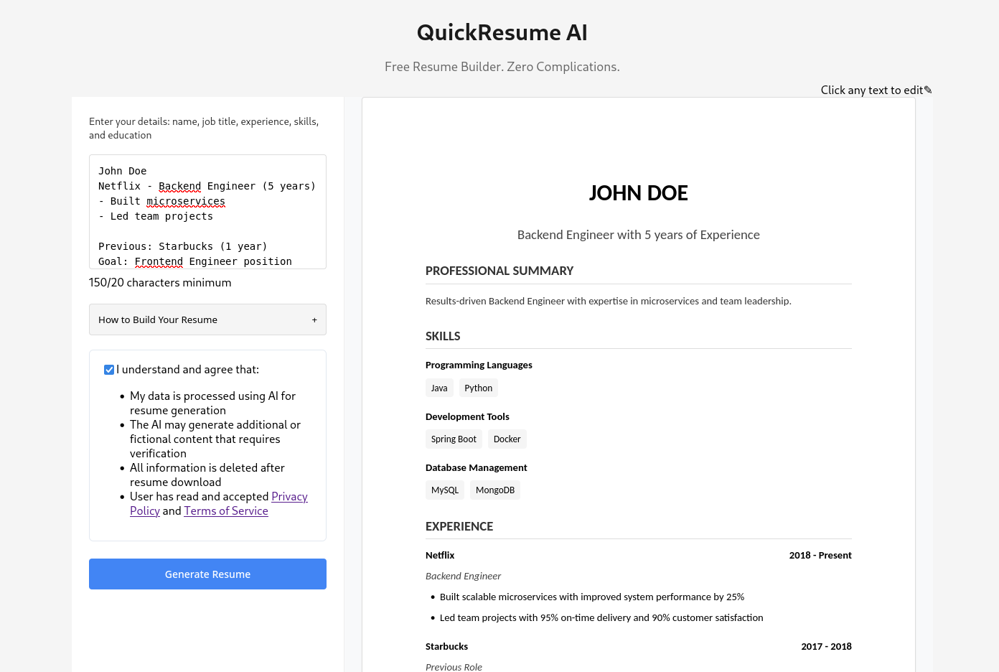

# ResumeQuick

AI resume builder: turn a few lines about your skills and experience into a
formatted resume, edit it live, check it against a job description, and
download it as a PDF.

Live site: [resumequick.pro](https://resumequick.pro)



## What it does

- Generates a structured resume (contact, headline, summary, experience,
  education, skills) from free-form input with a Groq-hosted LLM
  (`llama-3.1-8b-instant` by default, with retries).
- Guest mode (`/generate/guest`) plus signed-in mode with Google sign-in via
  Firebase Auth; users are stored in Firestore with a daily credit allowance
  (`DAILY_FREE_CREDITS`).
- Real-time editing with a live preview of the resume template.
- ATS check: compares resume text with a job description using a categorized
  skills dictionary (with synonyms) and returns a score plus matched and missing
  skills.
- PDF export: the backend renders the resume HTML to PDF with WeasyPrint.
- In production, the Flask app also serves the built React frontend and the
  legal pages.

## Tech stack

- **Backend**: Python 3.9+, Flask, Flask-CORS, firebase-admin (Auth +
  Firestore), Groq SDK (OpenAI client as an alternative provider), WeasyPrint,
  pypdf
- **Frontend**: React 18 (Create React App), React Router, Firebase JS SDK,
  CSS Modules
- **Infrastructure**: Firebase project (Authentication with the Google provider,
  Firestore)

## Getting started

### Prerequisites

- Python 3.9+ and Node.js 16+
- A Firebase project with Google sign-in enabled and a Firestore database
- A Groq API key ([groq.com](https://groq.com))
- WeasyPrint's system libraries (Pango etc.); see the
  [WeasyPrint install docs](https://doc.courtbouillon.org/weasyprint/stable/first_steps.html)

### 1. Backend

```bash
git clone https://github.com/maksimkunaev/resumequick.pro.git
cd resumequick.pro
python3 -m venv .venv && source .venv/bin/activate
pip install -r requirements.txt
cp .env.example .env    # then fill it in
```

Firebase Admin needs a service account key: download it from Firebase Console
-> Project Settings -> Service Accounts and save it as `serviceAccountKey.json`
in the repo root (see `serviceAccountKey.json.example` for the shape), or point
`FIREBASE_SERVICE_ACCOUNT_KEY` at it. The file is git-ignored.

Environment variables (`.env` in the repo root):

| Variable | Required | Notes |
|---|---|---|
| `PORT` | yes | Port for the Flask server (e.g. `8000`) |
| `DAILY_FREE_CREDITS` | yes | Daily credits per user |
| `GROQ_API_KEY` | yes | Used for resume generation |
| `STATIC_FOLDER` | for serving the frontend | Absolute path to `frontend/build` |
| `STATIC_URL_PATH` | no | Defaults to `/` |
| `SECOND_STATIC_FOLDER` | for legal pages | Absolute path to a folder with `privacy_policy.html`, `terms.html`, `refund_policy.html` (not included in this repo) |
| `FIREBASE_SERVICE_ACCOUNT_KEY` | no | Defaults to `serviceAccountKey.json`; leave unset rather than empty |
| `OPENAI_API_KEY` | no | Only if you switch the provider to OpenAI |
| `GMAIL_USERNAME`, `GMAIL_APP_PASSWORD`, `FEEDBACK_EMAIL_TO` | no | Used by `send_feedback_service.py` |

Use absolute paths for the static folders: Flask resolves relative paths
against `corekit/`, not the repo root.

Run the backend from the repo root (it imports `corekit.*` and
`feature_services.*` as packages):

```bash
python -m corekit.app   # http://localhost:8000 (or your PORT)
```

### 2. Frontend

The Firebase web config is set directly in
`frontend/src/lib/firebaseInit.js`. To use your own Firebase project, replace
the values there with the config from Firebase Console -> Project Settings ->
General -> Your apps.

Development (CRA dev server on port 3000; in development the frontend calls the
backend at `http://localhost:8000`, see `frontend/src/api/config.js`):

```bash
cd frontend
npm install
npm start
```

Production: build the frontend and let Flask serve it from `STATIC_FOLDER`:

```bash
cd frontend
npm install
npm run build
cd ..
python -m corekit.app
```

## API

| Route | Method | Auth | Purpose |
|---|---|---|---|
| `/generate/guest` | POST | no | Generate a resume as a guest |
| `/generate` | POST | Firebase ID token | Generate a resume for a signed-in user (uses credits) |
| `/download-resume` | POST | no | Render resume HTML to PDF |
| `/ats-evaluate` | POST | no | ATS score for `resumeText` vs `jobDescription` |
| `/auth/register` | POST | Firebase ID token | Create the user record in Firestore on first sign-in |
| `/auth/me` | GET | Firebase ID token | Current user and credits |

## Project structure

```
resumequick.pro/
├── corekit/                  # Flask app and HTTP layer
│   ├── app.py                # app setup, Firebase Admin init, static/SPA routes
│   ├── auth_service.py       # /auth/*, auth_required decorator, credits
│   ├── resume_service.py     # /generate, /generate/guest, /download-resume
│   ├── ats_service.py        # /ats-evaluate
│   └── constants.py          # per-feature credit prices (all free)
├── feature_services/         # business logic, independent of Flask
│   ├── llm/llm_client.py     # Groq / OpenAI client wrapper
│   ├── resume/               # prompt + model fallback for resume generation
│   ├── ats/main.py           # skills dictionary and ATS scoring
│   ├── download_service.py   # HTML -> PDF with WeasyPrint
│   └── send_feedback_service.py
├── frontend/                 # React app (Create React App)
│   ├── public/
│   └── src/
│       ├── api/              # calls to the backend
│       ├── components/       # form, preview, template, ATS score, modals
│       ├── hooks/            # useUser, useGuest
│       └── lib/              # Firebase init and auth helpers
├── requirements.txt
├── .env.example
└── serviceAccountKey.json.example
```

## Customization

- **Resume template**: `frontend/src/components/ResumeTemplate.js`
- **AI prompts and models**: `feature_services/resume/groq_service.py`
- **ATS skills dictionary**: `feature_services/ats/main.py`
- **Styling**: CSS Modules in `frontend/src/components/`

## Notes

- The frontend calls `/api/feedback/*` and `/legal-config`, but the backend has
  no routes for them yet; `send_feedback_service.py` is not wired to an
  endpoint.
- `requirements.txt` includes packages (spaCy, NLTK, TextBlob, scikit-learn,
  matplotlib) that the current code does not import.

## Troubleshooting

**Firebase authentication**
- Enable the Google sign-in provider in Firebase.
- Check that `serviceAccountKey.json` is in the repo root (or that
  `FIREBASE_SERVICE_ACCOUNT_KEY` points to it).
- Rebuild the frontend after changing `firebaseInit.js`: `npm run build`.

**Resume generation**
- Check that `GROQ_API_KEY` is valid and look at the server logs.

**PDF generation**
- Make sure WeasyPrint and its system libraries are installed.

## License

[MIT](LICENSE)
